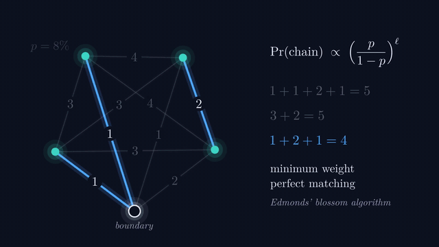
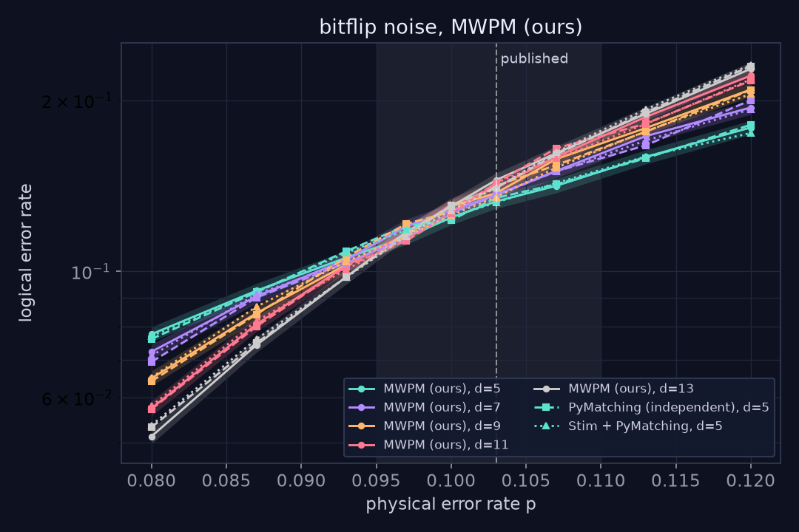

<p align="right"><picture><source media="(prefers-color-scheme: dark)" srcset="public/brand/team-phase-dark.svg"></picture></p>

# Below Threshold

**Factor a number with a quantum computer, then keep it alive.** An interactive guide to Shor's algorithm and the quantum Fourier transform, and to the quantum error correction needed to run them, ending on why real-time decoding is the bottleneck for fault-tolerant quantum computing.

> Live demo: https://bbfutaba.github.io/below-threshold/ (unlisted, `noindex`) · [3-minute pitch video](docs/media/below-threshold-pitch.mp4) ([script, in four sections](docs/pitch-video-script.md), [section clips](docs/media/pitch-sections/)) · [The film](https://bbfutaba.github.io/below-threshold/film) ([1080p](docs/media/below-threshold-film.mp4), [subtitles](docs/media/below-threshold-film.srt)) · [Technical write-up](docs/writeup.md) · [Validation report](docs/validation-report.md) · [Backup demo video](docs/media/demo.webm)



## What you can do

| | |
|---|---|
| **Learn** | Twelve short chapters on an exact state-vector simulator, in three parts. **Part I, Quantum basics:** what a qubit is (superposition, measurement, interference), many qubits at once (2ⁿ amplitudes, product states), and entanglement. **Part II, Shor's algorithm:** factoring as a hunt for a period, phase as a hidden clock, the quantum Fourier transform, Shor's algorithm end to end, and what noise does to it. **Part III, Keeping it alive:** no-cloning, syndrome extraction, phase errors, error discretization. Open any chapter in any order; each has its own URL (`/learn/qft`). |
| **QFT** | The featured chapter: pick a single number or a repeating pattern, step through the real gate circuit (Hadamards, controlled phase turns, swaps) one gate at a time, and watch amplitudes as clocks, each qubit's Bloch arrow and the output peaks. Ends with a "frequency detective" challenge. |
| **Shor's** | Factor 15, 21, 33 or 35 in seven steps: superpose, compute aˣ mod N, measure (the comb), QFT (the peaks), measure, continued fractions, gcd. Run it 50 times to see how often one run succeeds. A noise chapter runs the gate-level circuit on 10 qubits and watches the peaks dissolve. |
| **Play** | Keep a Shor's algorithm run alive by protecting its logical qubit on a rotated surface code (d = 3, 5, 7). Errors are hidden and only lit checks ("alarms") are visible, like real hardware. A guided first level, a plain-language guide for each level, live coaching after every move and alarms that show which qubits they watch make it playable with no background. Clear the alarms, submit, see what really happened, then watch the decoder play the same seeded puzzle. |
| **Checks that lie** | Measurement errors: label detection-event pairs in a time stack, then see the decoder's space-time matching. |
| **Real-time** | Rounds arrive on a clock; decoder speed is **measured live in your browser**. Slow decoders build a backlog and T gates stall. |
| **Lab** | Live Monte Carlo in Web Workers: watch curves for different distances cross at the threshold, drag the noise level, read off the suppression factor Λ. |
| **Leaderboard** | Humans vs the decoder on identical seeded puzzles; QR event mode; optional shared board. |
| **Film** | A ~15-minute narrated explainer in the style of 3Blue1Brown and 2swap (Manim + LaTeX), fourteen chapters in the same three parts: quantum basics (a qubit, many qubits, entanglement), Shor's algorithm and the QFT, then error correction as the wrap-up. Every frame is drawn from the same simulation code. Each chapter also appears next to its interactive version in the app. |

## Is it real?

Yes. Every number in the app is computed live or comes from the validation suite in this repo.

- **Shor and the QFT.** The QFT gate circuit equals the exact discrete Fourier transform on random states (1 to 7 qubits); without noise, the gate-level Shor circuit (Hadamards, controlled modular multiplications, QFT) reproduces the register-level distribution exactly.
- **Correctness.** Our blossom MWPM matches brute force on every instance with up to 16 defects, and matches PyMatching's correction weight on **100%** of 90,000 exported decoding problems. Our layout equals Stim's generated rotated surface code for d = 3 to 11. 125 unit tests, 66 end-to-end checks (desktop and mobile).
- **Thresholds**, reproduced with our own decoders up to d = 13:

| Noise | Decoder | Ours | Stim / PyMatching reference | Published |
|---|---|---|---|---|
| Bit flip | MWPM | 9.94% | 9.85% | ≈ 10.3% |
| Bit flip | Union-find | 9.59% | | ≈ 9.9% |
| With measurement errors | MWPM | 2.84% | 2.85% | ≈ 2.9% |
| With measurement errors | Union-find | 2.48% | | ≈ 2.6% |
| Depolarizing | MWPM | 14.6% | | ≈ 15.5% |



- **What we simplify** (also shown in the app): Shor's algorithm on small numbers (15 to 35), with exact registers in the walkthrough and a 10-qubit gate-level noise simulation that treats each controlled modular multiplication as one exact gate; code-capacity and phenomenological noise, not circuit-level; X and Z decoded separately; a slowed clock and a labeled hardware speed-up in real-time mode; small distances. See [the honesty page](src/ui/screens/Honesty.tsx) and the [write-up](docs/writeup.md).

## Quick start

Requires Node 20+ (and Python 3.11+ for validation).

```bash
npm install
npm run dev            # http://localhost:5173
npm test               # Vitest unit and property tests
npm run build && npm run test:e2e   # Playwright smoke tests (desktop and mobile)
```

Validation suite (Python 3.11):

```bash
python -m venv .venv && .venv/Scripts/pip install -r validate/requirements.txt   # or .venv/bin/pip
npm run export:instances                 # seeded instances -> validate/data/
.venv/Scripts/python validate/cross_check.py    # PyMatching cross-check + Stim layout check
.venv/Scripts/python validate/thresholds.py     # thresholds, plots, docs/validation-report.md (~5 min on 32 threads)
npm run bench                            # decoder timing -> src/data/bench.json
```

The explainer film is rendered with Manim from real simulation data, and its timing follows the narration script: see [media/README.md](media/README.md). To record the voiceover, follow [docs/voiceover-script.md](docs/voiceover-script.md) (one file per line into `media/voiceover/recordings/`, then `media/film_build.py --final`).

## Deploy

- **GitHub Pages (live deployment):** every push to `main` runs `.github/workflows/pages.yml`, which builds with the repo name as base path and deploys to https://bbfutaba.github.io/below-threshold/. Pages cannot set cross-origin-isolation headers; decoder timing still works because each decode is repeated until at least 0.5 ms has elapsed. The page carries a `noindex, nofollow` robots tag.
- **Vercel (alternative):** import the repo; `vercel.json` adds SPA rewrites and cross-origin-isolation headers (microsecond timer resolution for real-time mode).
- **Optional shared leaderboard:** set `VITE_SUPABASE_URL` and `VITE_SUPABASE_ANON_KEY` (table schema in `src/ui/leaderboardApi.ts`). The app works fully without it.
- **Offline at the venue:** `npm run build && npm run preview`.

## Project structure

```
src/core/          pure physics, no React: rng, quantum, qft, shor, surfaceCode, pauliFrame, noise,
                   decodingGraph, decoders/ (exactSmall, blossom + mwpm, unionFind, greedy),
                   stats, simulate, game, realtime, timeStack, exportInstances
src/workers/       Monte Carlo and live decoder timing (Comlink)
src/ui/            design tokens, shared components (Lattice, BlochSphere, ThresholdChart, ...), screens
tests/core/        Vitest unit and property tests     tests/e2e/   Playwright smoke tests
validate/          Python: cross_check.py, thresholds.py, plots/
media/             Manim scenes and their data export  docs/        write-up, pitch, Q&A, plan, report
```

## Team

Built by **Team PhASE** for the Quantum Unlocked track. The logo's wordmark is set in Latin Modern (the OpenType Computer Modern, GUST Font License); the mark is a phase diagram. Sources: `media/brand/`.

All four of us are in the NYU MS in Applied Quantum Science and Technology program (also on the site's [Team page](https://bbfutaba.github.io/below-threshold/team)).

| Member | Email | Roles |
| --- | --- | --- |
| Prahlad MV | pmv6845@nyu.edu | Coder, Voice Over, Theory Crafting |
| Dennis Li | zl2941@nyu.edu | Coder, Voice Over, Theory Crafting |
| Ben Kahl | bk3362@nyu.edu | Voice Over, Theory Crafting |
| Siwei Zhang | sz5789@nyu.edu | Voice Over, Theory Crafting |

## Prior art and credits

Error-correction games exist, notably James Wootton's *Decodoku* (around 2016). Below Threshold adds the quantum basics, a decoder replay, measurement errors, the real-time backlog and a validated threshold lab in one experience. The blossom implementation is a TypeScript port of Joris van Rantwijk's public-domain `mwmatching.py`. Validation uses [Stim](https://github.com/quantumlib/Stim) and [PyMatching](https://github.com/oscarhiggott/PyMatching). Full references: [CITATIONS.md](CITATIONS.md).

## License

MIT
