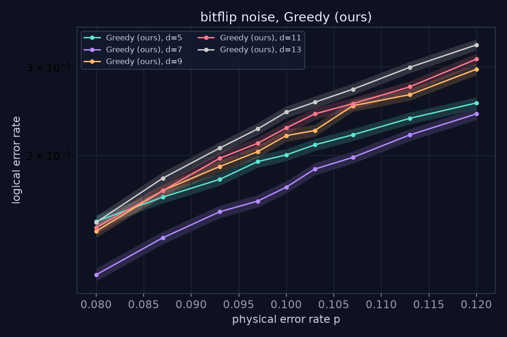
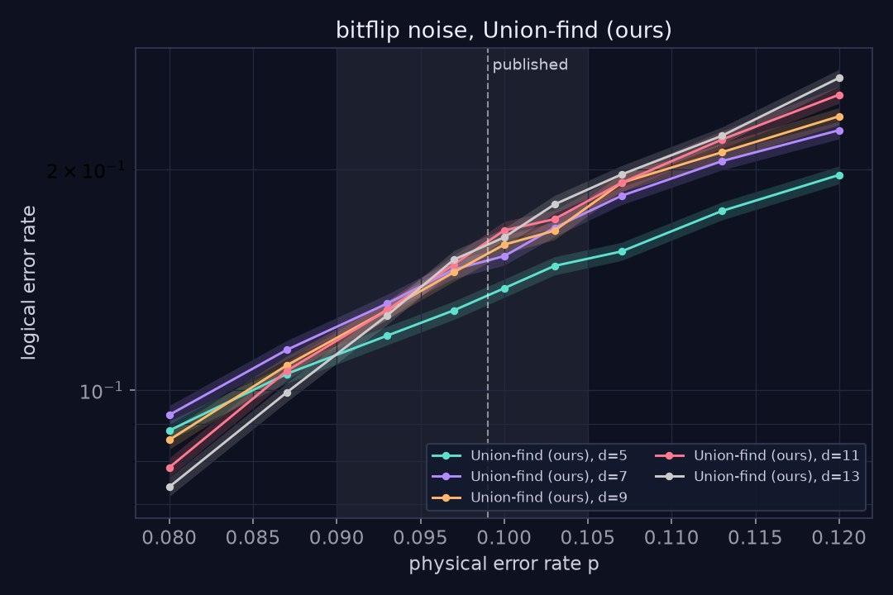
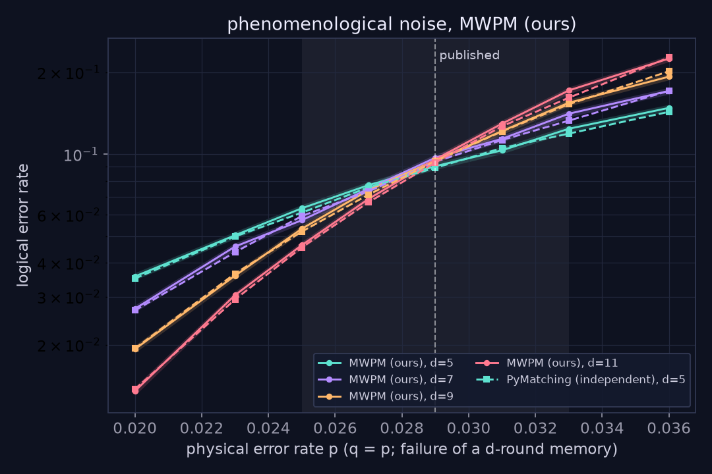
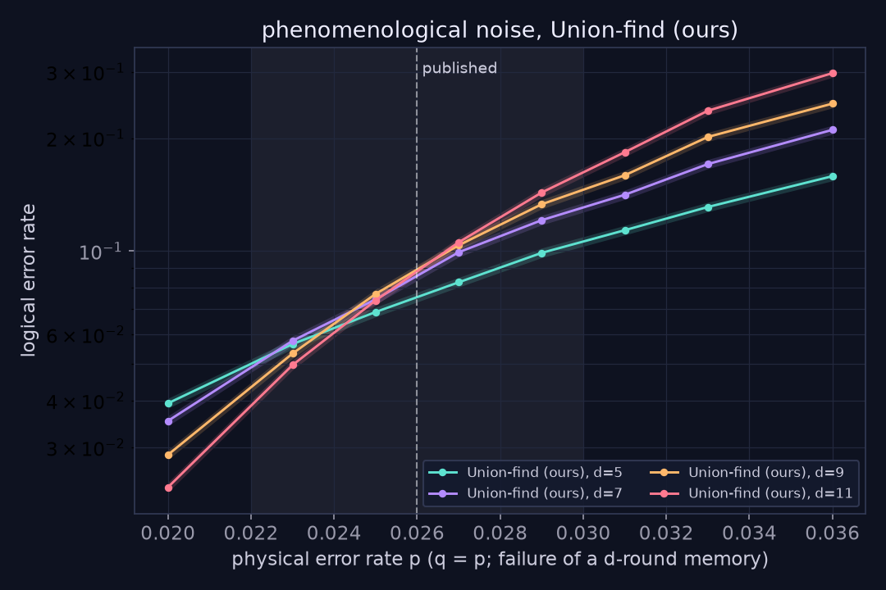
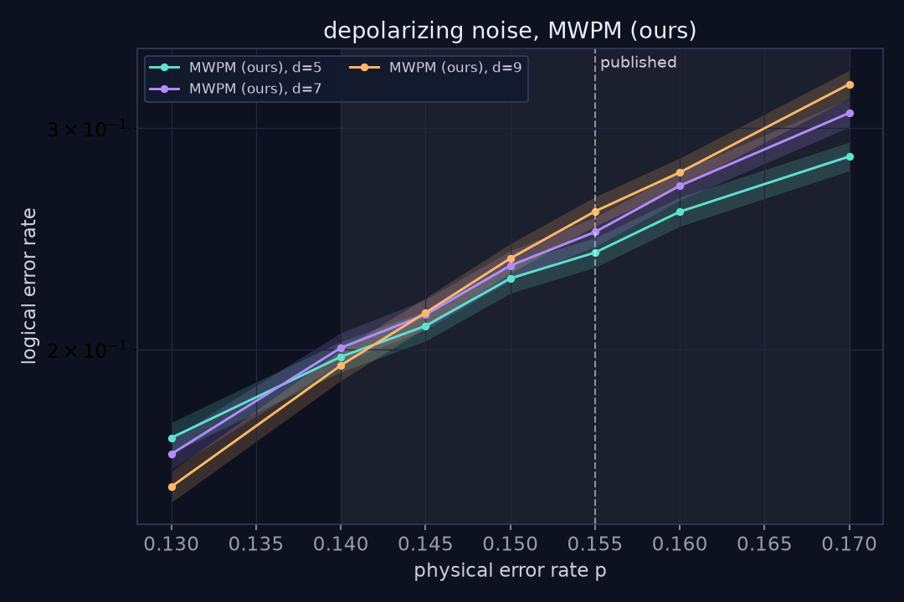

# Validation report

Generated by `validate/thresholds.py` on 2026-10-09T17:01:38  
Machine: AMD64 Family 26 Model 68 Stepping 0, AuthenticAMD (32 threads), Windows 10; Python 3.11.6, Stim 1.16.0, PyMatching 2.4.0  
The estimate is a finite-size scaling fit (Wang, Harrington and Preskill 2003) over distances d >= 7, since the smallest code carries the largest finite-size corrections; the fit over all distances and every pairwise crossing of smoothed curves are listed per model below, so nothing is hidden.  
Sampling: each point runs until 4000 logical failures or 200,000 trials, whichever comes first. Error bars are 95% Wilson intervals; crossing ranges are 95% bootstrap intervals.

## Threshold reproduction

| Noise model | Decoder | Our estimate | Range across distance pairs | Published (approx.) | Acceptance band | Result |
|---|---|---|---|---|---|---|
| bitflip | MWPM (ours) | 9.94% | 9.20% to 10.03% | 10.30% | 9.50% to 11.00% | pass |
| bitflip | Union-find (ours) | 9.59% | 9.28% to 9.85% | 9.90% | 9.00% to 10.50% | pass |
| phenomenological | MWPM (ours) | 2.84% | 2.71% to 2.88% | 2.90% | 2.50% to 3.30% | pass |
| phenomenological | Union-find (ours) | 2.48% | 2.23% to 2.58% | 2.60% | 2.20% to 3.00% | pass |
| depolarizing | MWPM (ours) | 14.63% | 13.85% to 14.58% | 15.50% | 14.00% to 17.00% | pass |

Phenomenological thresholds use the failure probability of a whole d-round memory experiment (d noisy rounds plus a perfect final readout, q = p), which is how the published 2.9% (MWPM) and 2.6% (union-find) are defined. Per-round rates are listed below; they cross at a higher p because a bigger code also runs more rounds. Depolarizing code capacity is decoded with X and Z independently, so its threshold is the bit-flip threshold times 3/2 (the X part of depolarizing noise has probability 2p/3).

### bitflip

- **MWPM (ours)**: scaling fit (d >= 7) 9.94%, all distances 9.76%; pairwise crossings d=5/7: 9.20% [8.86%, 9.63%]; d=7/9: 9.96% [9.53%, 10.38%]; d=9/11: 9.68% [9.28%, 10.13%]; d=11/13: 10.03% [9.62%, 10.63%]
- **Union-find (ours)**: scaling fit (d >= 7) 9.59%, all distances 8.93%; pairwise crossings d=5/7: n/a [n/a, n/a]; d=7/9: 9.76% [9.22%, 10.37%]; d=9/11: 9.28% [8.90%, 9.71%]; d=11/13: 9.85% [9.31%, 10.43%]
- **Greedy (ours)**: scaling fit (d >= 7) n/a, all distances n/a; pairwise crossings d=5/7: n/a [n/a, n/a]; d=7/9: n/a [n/a, n/a]; d=9/11: n/a [8.01%, 8.77%]; d=11/13: n/a [n/a, n/a]
- **PyMatching (independent sampling and graph)**: scaling fit (d >= 7) 9.85%, all distances 9.78%; pairwise crossings d=5/7: 9.97% [9.60%, 10.36%]; d=7/9: 9.23% [8.89%, 9.69%]; d=9/11: 10.12% [9.64%, 10.60%]; d=11/13: 10.17% [9.59%, 10.64%]
- **Stim circuit + PyMatching**: scaling fit (d >= 7) 9.85%, all distances 9.78%; pairwise crossings d=5/7: 9.80% [9.32%, 10.16%]; d=7/9: 9.91% [9.39%, 10.51%]; d=9/11: 9.71% [9.30%, 10.12%]; d=11/13: 10.04% [9.55%, 10.45%]

### phenomenological

- **MWPM (ours)**: scaling fit (d >= 7) 2.84%, all distances 2.80%; pairwise crossings d=5/7: 2.71% [2.64%, 2.80%]; d=7/9: 2.85% [2.77%, 2.93%]; d=9/11: 2.88% [2.81%, 2.95%]
  - per-round rates instead of per-memory: crossings d=5/7: n/a; d=7/9: n/a; d=9/11: 3.59% (n/a = no crossing below the top of the sampled range, 3.6%; per-round curves cross higher, as expected)
- **Union-find (ours)**: scaling fit (d >= 7) 2.48%, all distances 2.39%; pairwise crossings d=5/7: 2.23% [2.17%, 2.29%]; d=7/9: 2.48% [2.42%, 2.56%]; d=9/11: 2.58% [2.51%, 2.66%]
  - per-round rates instead of per-memory: crossings d=5/7: 3.44%; d=7/9: n/a; d=9/11: 3.26% (n/a = no crossing below the top of the sampled range, 3.6%; per-round curves cross higher, as expected)
- **PyMatching (independent sampling and graph)**: scaling fit (d >= 7) 2.85%, all distances 2.81%; pairwise crossings d=5/7: 2.73% [2.65%, 2.81%]; d=7/9: 2.84% [2.77%, 2.91%]; d=9/11: 2.96% [2.88%, 3.04%]
  - per-round rates instead of per-memory: crossings d=5/7: n/a; d=7/9: n/a; d=9/11: n/a (n/a = no crossing below the top of the sampled range, 3.6%; per-round curves cross higher, as expected)

### depolarizing

- **MWPM (ours)**: scaling fit (d >= 7) 14.63%, all distances 14.24%; pairwise crossings d=5/7: 13.85% [13.20%, 14.68%]; d=7/9: 14.58% [14.03%, 15.24%]

## Cross-check against PyMatching

10,000 seeded instances per configuration exported from the app (`npm run export:instances`) and decoded by PyMatching on the same graph and weights (`validate/cross_check.py`).

| Config | Error type | Instances | Weight agrees | Logical agrees | Our failures | PyMatching failures | McNemar p | Result |
|---|---|---|---|---|---|---|---|---|
| bitflip_d3 | X | 10,000 | 100.00% | 100.00% | 1223 | 1223 | 1.00 | pass |
| bitflip_d5 | X | 10,000 | 100.00% | 100.00% | 1215 | 1215 | 1.00 | pass |
| bitflip_d7 | X | 10,000 | 100.00% | 100.00% | 943 | 943 | 1.00 | pass |
| bitflip_d9 | X | 10,000 | 100.00% | 100.00% | 646 | 646 | 1.00 | pass |
| depolarizing_d5 | X | 10,000 | 100.00% | 100.00% | 786 | 786 | 1.00 | pass |
| depolarizing_d5 | Z | 10,000 | 100.00% | 100.00% | 767 | 767 | 1.00 | pass |
| phenom_d3 | X | 10,000 | 100.00% | 96.47% | 722 | 727 | 0.83 | pass (tie rule) |
| phenom_d5 | X | 10,000 | 100.00% | 93.98% | 938 | 912 | 0.31 | pass (tie rule) |
| phenom_d5_unequal | X | 10,000 | 100.00% | 100.00% | 397 | 397 | 1.00 | pass |

**Ties.** With p = q every edge of the phenomenological graph has weight 1, so many syndromes have several minimum-weight corrections in different logical classes. On those instances both decoders return a correction of exactly the same (minimum) weight, so every logical disagreement is a proven tie, not a decoder error. The plan's 99.9% per-instance rule is kept for every configuration with non-degenerate weights (including p != q phenomenological noise, which agrees on 100%); for the degenerate ones we require 100% weight agreement and an exact McNemar test showing our tie-breaking is not biased toward failures.

**Layout.** Our rotated surface code stabilizers equal those of Stim's generated `surface_code:rotated_memory_z` circuit for d = 3 to 11, up to transpose+swapXZ (a relabeling: Stim puts the X-type boundary on the left and right).

## Decoder speed

`npm run bench` on AMD Ryzen 9 9950X 16-Core Processor            , Node v22.18.0 (2026-10-09). Phenomenological noise, q = p, d rounds; time per round = decode time / (d + 1) layers. Real superconducting hardware produces about one round per microsecond.

| d | p | MWPM median (us) | MWPM p99 | Union-find median | Union-find p99 | Greedy median | Greedy p99 |
|---|---|---|---|---|---|---|---|
| 3 | 0.01 | 0.2 | 14.9 | 0.1 | 3.6 | 0.2 | 2.4 |
| 3 | 0.03 | 2.7 | 15.8 | 2.2 | 26.2 | 0.3 | 1.7 |
| 3 | 0.05 | 2.7 | 30.6 | 2.4 | 7.0 | 0.5 | 3.5 |
| 5 | 0.01 | 2.6 | 27.7 | 2.7 | 23.3 | 0.2 | 1.1 |
| 5 | 0.03 | 12.4 | 93.6 | 1.7 | 17.5 | 0.6 | 2.6 |
| 5 | 0.05 | 23.9 | 137.1 | 1.9 | 7.4 | 1.4 | 4.4 |
| 7 | 0.01 | 8.0 | 49.1 | 1.7 | 21.5 | 0.5 | 2.3 |
| 7 | 0.03 | 23.2 | 74.7 | 2.5 | 5.4 | 4.2 | 13.4 |
| 7 | 0.05 | 60.9 | 155.5 | 3.4 | 8.0 | 9.1 | 20.4 |
| 9 | 0.01 | 12.0 | 56.5 | 2.4 | 11.3 | 2.2 | 9.3 |
| 9 | 0.03 | 103.5 | 261.0 | 4.0 | 9.3 | 15.4 | 33.3 |
| 9 | 0.05 | 324.9 | 670.8 | 5.8 | 18.8 | 36.5 | 61.4 |
| 11 | 0.01 | 33.7 | 105.2 | 3.3 | 15.0 | 6.3 | 16.1 |
| 11 | 0.03 | 544.9 | 1193.1 | 9.2 | 31.7 | 63.1 | 114.9 |
| 11 | 0.05 | 1926.7 | 3949.2 | 12.8 | 35.1 | 146.0 | 241.9 |
